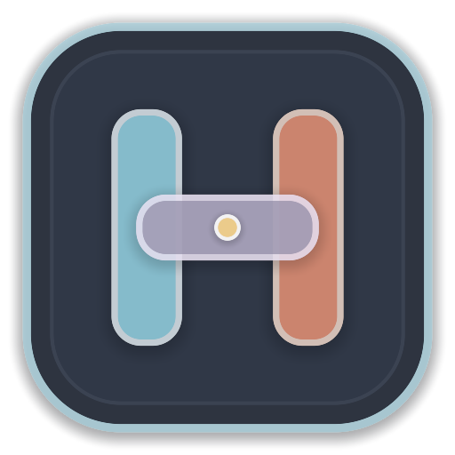

<p align="center">
  
</p>

<h1 align="center">Huey</h1>

<p align="center">
  <strong>A tiny, fast, data-oriented cross-platform GUI toolkit in Zig — desktop, mobile, wearables, and beyond.</strong>
</p>

> *~340 KB signed Android & Wear OS APKs · 60 Hz on a 2014 Nexus 9 & OnePlus Watch 3 · 0% idle CPU*
> *Today: Linux Wayland, Android & Wear OS · Planned: macOS (Metal), Windows (D3D11), iOS & Web*

---

## Why Huey?

Modern GUI toolkits got heavy. A simple watch key app or desktop launcher shouldn't ship a 40 MB runtime, burn battery polling at 60 Hz when nothing is moving, or drop frames on a modest mobile GPU.

Huey solves five everyday GUI problems:

- **Bloat & slow cold starts** — compiles to a single ~300 KB native library with zero JVM/Electron/Compose overhead.
- **Idle battery drain** — sleeps at **0% CPU** via `ALooper` / `AChoreographer` / `epoll` and wakes only on input, scroll, or active springs.
- **Fragile draw-call soup** — draws rounded cards, crisp borders, soft shadows, clips, circular watch masks, and text in **a single GPU pass**.
- **Muddy colors & jarring motion** — blends colors in true linear light, themes in perceptual **Oklab** (with WCAG contrast guards & OS dark/light hooks), and animates with rock-solid spring physics.
- **Untestable UIs** — includes a deterministic headless renderer that outputs PNGs, layout trees, and automatic contrast/overlap lints in milliseconds.

---

## The Short Manifesto

1. **One Shader, One Pass.** Everything on screen — shapes, borders, shadows, and cached font glyphs — is drawn in one batched GPU call (`sokol_gfx`).
2. **Zero-Tick Sleep.** If nothing is moving, the app does nothing.
3. **Flat Data, Not Deep Objects.** Cache-friendly flat arrays, zero per-frame heap churn, and instant scrolling across 1M+ rows.
4. **Perceptual Color & Real Physics.** Oklab palettes + damped spring motion, never hardcoded themes.
5. **Native Everywhere.** Built on `sokol_gfx` so one core targets every GPU backend — running today on Linux Wayland, Android, and natively circular Wear OS, with macOS (Metal), Windows (D3D11), iOS, and Web next, plus a thin C ABI ([`include/huey.h`](include/huey.h)).
6. **Built for Humans & Agents.** Flat APIs, declarative JSON scenes, and deterministic headless verification — no custom scripting DSL.

Read the full version in [`docs/MANIFESTO_v2.2.md`](docs/MANIFESTO_v2.2.md) and the API cookbook in [`SKILL.md`](SKILL.md).

---

## Quick Start

Requires **Zig 0.16.0** (plus Android SDK/NDK for mobile/watch builds).

```bash
# Run all 35 host unit test suites
zig build test

# Build & run the Wayland status bar / launcher prototype
zig build stratifi-demo && ./zig-out/bin/huey-stratifi --headless

# Build Android tablet & Wear OS showcase APKs
./build_apk.sh
./build_wear_apk.sh
```

---

## License

Dual-licensed under either the **MIT License** ([`LICENSE-MIT`](LICENSE-MIT)) or the **Apache License, Version 2.0** ([`LICENSE-APACHE`](LICENSE-APACHE)), at your option.
